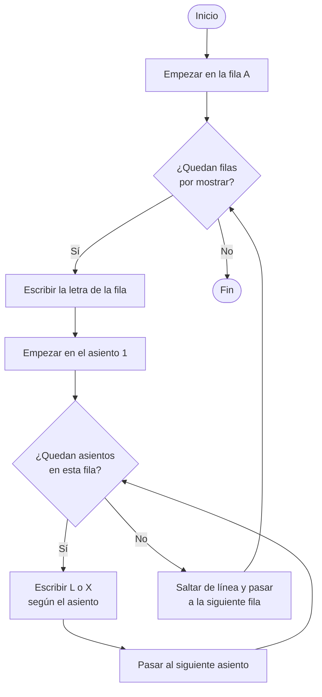
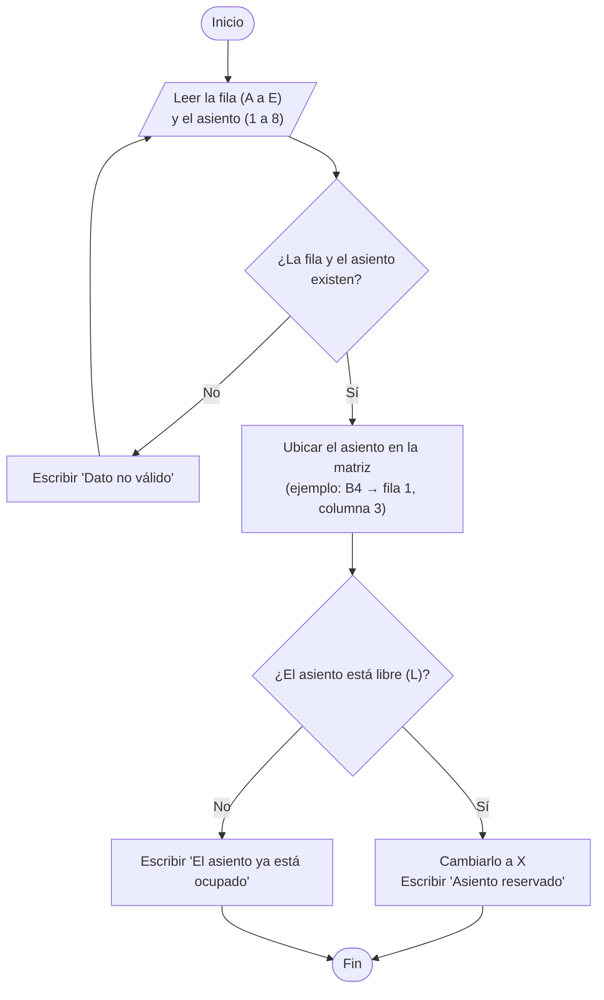
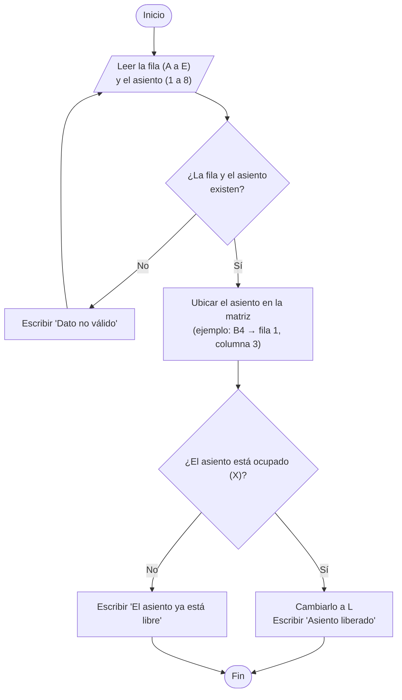

# Día 2: Diseño algorítmico

## Mostrar sala, reservar y liberar asiento

**Hecho por:** Aldo David Cruz Jaimes

La sala es una matriz llamada `sala` de 5 filas (A a E) y 8 asientos por fila (1 a 8).
Cada asiento guarda **L** si está libre o **X** si está ocupado.

---

## 1. Mostrar sala

### Pasos

1. Empezar en la primera fila.
2. Escribir la letra de la fila.
3. Recorrer los 8 asientos de esa fila y escribir lo que tiene cada uno (L o X).
4. Saltar de línea y pasar a la siguiente fila.
5. Repetir hasta terminar las 5 filas.

### Diagrama de flujo



### Pseudocódigo

```
PROCESO MostrarSala
    PARA fila DESDE 0 HASTA 4
        ESCRIBIR la letra de la fila
        PARA columna DESDE 0 HASTA 7
            ESCRIBIR sala[fila][columna]
        FIN PARA
        SALTAR DE LÍNEA
    FIN PARA
FIN PROCESO
```

---

## 2. Reservar asiento

### Pasos

1. Pedir la fila (A a E) y el número de asiento (1 a 8).
2. Si los datos no son válidos, mostrar un mensaje y volver a pedirlos.
3. Convertir la letra y el número a posiciones de la matriz (A = 0, B = 1 ... y número − 1).
4. Si el asiento tiene **L**, cambiarlo a **X** y mostrar "Asiento reservado".
5. Si tiene **X**, mostrar "El asiento ya está ocupado".

### Diagrama de flujo



### Pseudocódigo

```
PROCESO ReservarAsiento
    LEER letra, numero
    MIENTRAS letra no esté entre A y E O numero no esté entre 1 y 8
        ESCRIBIR "Dato no válido, intenta de nuevo"
        LEER letra, numero
    FIN MIENTRAS

    fila = posición de la letra (A=0, B=1, C=2, D=3, E=4)
    columna = numero - 1

    SI sala[fila][columna] = 'L' ENTONCES
        sala[fila][columna] = 'X'
        ESCRIBIR "Asiento reservado"
    SINO
        ESCRIBIR "El asiento ya está ocupado"
    FIN SI
FIN PROCESO
```

---

## 3. Liberar asiento

### Pasos

1. Pedir la fila (A a E) y el número de asiento (1 a 8).
2. Si los datos no son válidos, mostrar un mensaje y volver a pedirlos.
3. Convertir la letra y el número a posiciones de la matriz.
4. Si el asiento tiene **X**, cambiarlo a **L** y mostrar "Asiento liberado".
5. Si tiene **L**, mostrar "El asiento ya está libre".

### Diagrama de flujo



### Pseudocódigo

```
PROCESO LiberarAsiento
    LEER letra, numero
    MIENTRAS letra no esté entre A y E O numero no esté entre 1 y 8
        ESCRIBIR "Dato no válido, intenta de nuevo"
        LEER letra, numero
    FIN MIENTRAS

    fila = posición de la letra (A=0, B=1, C=2, D=3, E=4)
    columna = numero - 1

    SI sala[fila][columna] = 'X' ENTONCES
        sala[fila][columna] = 'L'
        ESCRIBIR "Asiento liberado"
    SINO
        ESCRIBIR "El asiento ya está libre"
    FIN SI
FIN PROCESO
```
