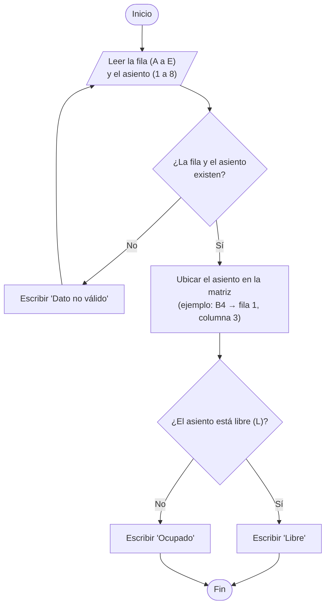
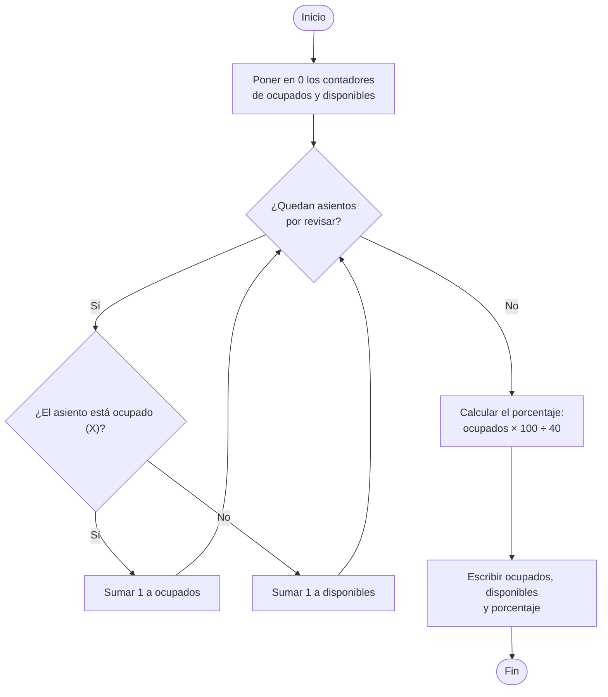

# Día 2: Diseño algorítmico

## Consultar disponibilidad y estadísticas

**Hecho por:** Luis Eduardo Mendoza Romero

La sala es una matriz llamada `sala` de 5 filas (A a E) y 8 asientos por fila (1 a 8).
Cada asiento guarda **L** si está libre o **X** si está ocupado.

---

## 1. Consultar disponibilidad

### Pasos

1. Pedir la fila (A a E) y el número de asiento (1 a 8).
2. Si los datos no son válidos, mostrar un mensaje y volver a pedirlos.
3. Convertir la letra y el número a posiciones de la matriz (A = 0, B = 1 ... y número − 1).
4. Si el asiento tiene **L**, mostrar "Libre".
5. Si tiene **X**, mostrar "Ocupado".

### Diagrama de flujo



### Pseudocódigo

```
PROCESO ConsultarAsiento
    LEER letra, numero
    MIENTRAS letra no esté entre A y E O numero no esté entre 1 y 8
        ESCRIBIR "Dato no válido, intenta de nuevo"
        LEER letra, numero
    FIN MIENTRAS

    fila = posición de la letra (A=0, B=1, C=2, D=3, E=4)
    columna = numero - 1

    SI sala[fila][columna] = 'L' ENTONCES
        ESCRIBIR "Libre"
    SINO
        ESCRIBIR "Ocupado"
    FIN SI
FIN PROCESO
```

---

## 2. Estadísticas: contar asientos y porcentaje de ocupación

### Pasos

1. Empezar con ocupados = 0 y disponibles = 0.
2. Revisar todos los asientos de la sala, uno por uno.
3. Si el asiento tiene **X**, sumar 1 a ocupados. Si tiene **L**, sumar 1 a disponibles.
4. Calcular el porcentaje: ocupados × 100 ÷ 40.
5. Mostrar ocupados, disponibles y porcentaje.

### Diagrama de flujo



### Pseudocódigo

```
PROCESO Estadisticas
    ocupados = 0
    disponibles = 0

    PARA fila DESDE 0 HASTA 4
        PARA columna DESDE 0 HASTA 7
            SI sala[fila][columna] = 'X' ENTONCES
                ocupados = ocupados + 1
            SINO
                disponibles = disponibles + 1
            FIN SI
        FIN PARA
    FIN PARA

    porcentaje = ocupados * 100 / 40

    ESCRIBIR "Ocupados: ", ocupados
    ESCRIBIR "Disponibles: ", disponibles
    ESCRIBIR "Porcentaje de ocupación: ", porcentaje, "%"
FIN PROCESO
```
