# Pruebas del programa

Probamos cada opción del menú, también los casos con error. En todas salió lo que esperábamos.

| # | Prueba | Lo que debe salir | ¿Funcionó? | Captura |
|---|---|---|---|---|
| 1 | Abrir el programa | Sale el menú | Sí | [01_Menu.png](01_Menu.png) |
| 2 | Reservar A1 | "Asiento reservado." | Sí | [02_Reservar.png](02_Reservar.png) |
| 3 | Reservar A1 otra vez | "El asiento ya está ocupado." | Sí | [03_Reservar_ocupado.png](03_Reservar_ocupado.png) |
| 4 | Reservar B4 y C7 y ver la sala | X en A1, B4 y C7 | Sí | [04_Mostrar_sala.png](04_Mostrar_sala.png) |
| 5 | Consultar B4 | "Ocupado" | Sí | [05_Consultar.png](05_Consultar.png) |
| 6 | Ver estadísticas | 3 ocupados, 37 libres, 7.5 % | Sí | [06_Estadisticas.png](06_Estadisticas.png) |
| 7 | Liberar C7 | "Asiento liberado." | Sí | [07_Liberar.png](07_Liberar.png) |
| 8 | Liberar C7 otra vez | "El asiento ya está libre." | Sí | [08_Liberar_libre.png](08_Liberar_libre.png) |
| 9 | Escribir F en el menú | "Dato no válido, intenta de nuevo." | Sí | [09_Dato_no_valido.png](09_Dato_no_valido.png) |
| 10 | Elegir 6 | "Gracias por usar el sistema." | Sí | [10_Salir.png](10_Salir.png) |
| 11 | Ver el historial en GitHub | Commits de los dos | Sí | [11_Commits_GitHub_1.png](11_Commits_GitHub_1.png) |

## Prueba 1: Abrir el programa

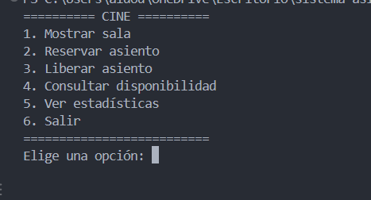

## Prueba 2: Reservar A1

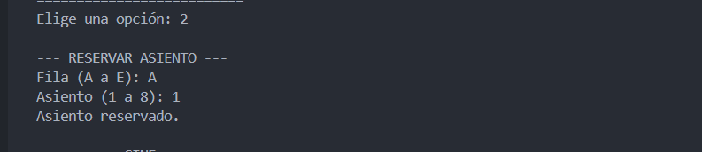

## Prueba 3: Reservar A1 otra vez

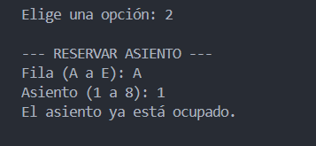

## Prueba 4: Ver la sala

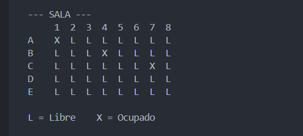

## Prueba 5: Consultar B4

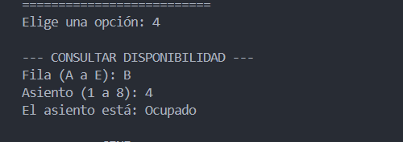

## Prueba 6: Ver estadísticas

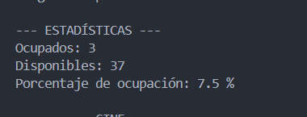

## Prueba 7: Liberar C7

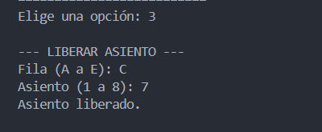

## Prueba 8: Liberar C7 otra vez

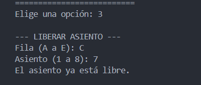

## Prueba 9: Escribir F en el menú

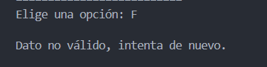

## Prueba 10: Salir

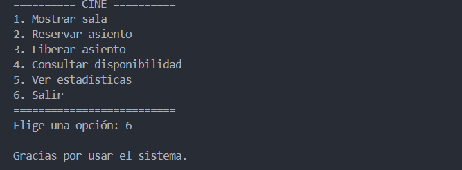

## Prueba 11: Historial de commits

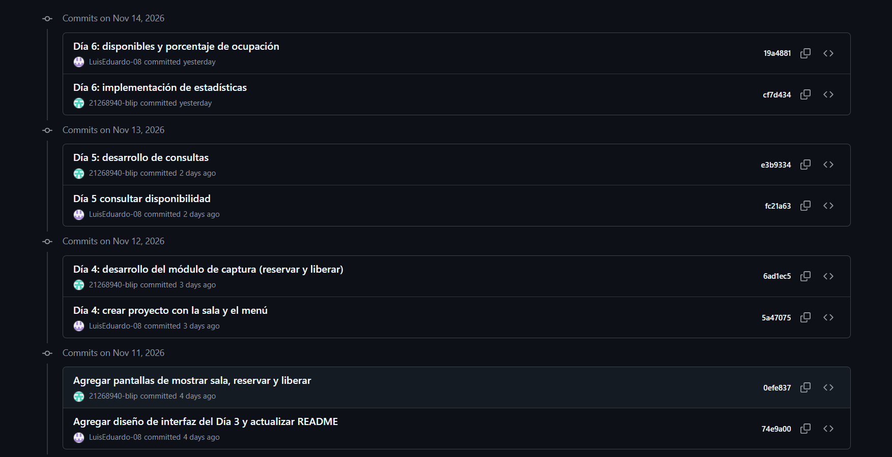

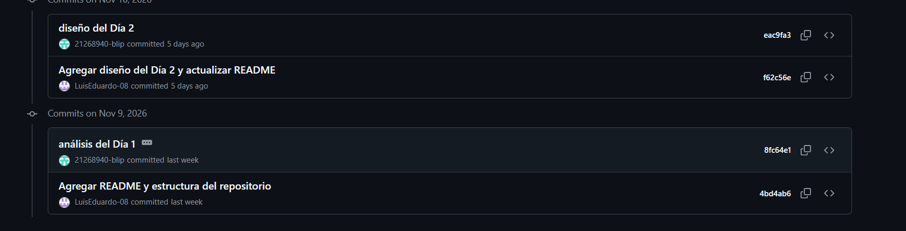

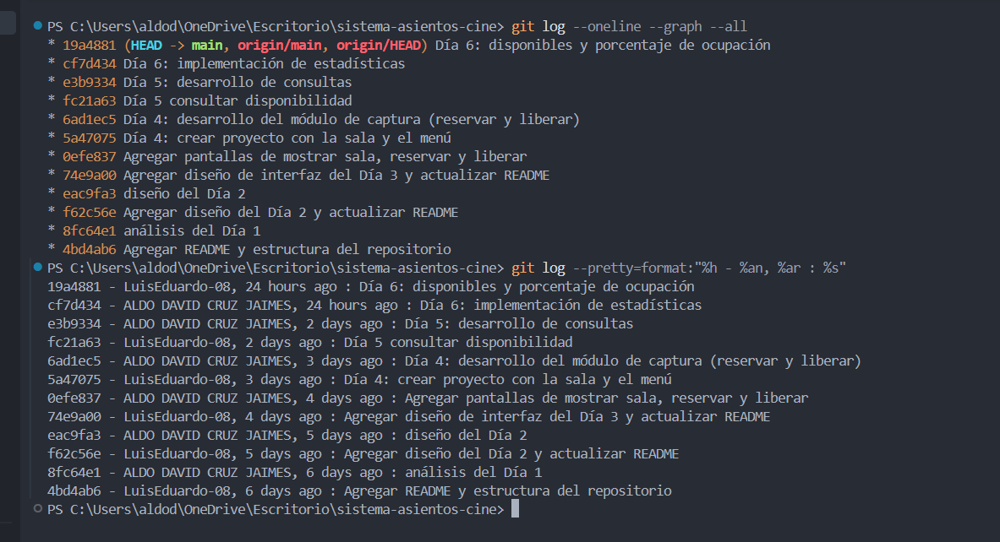